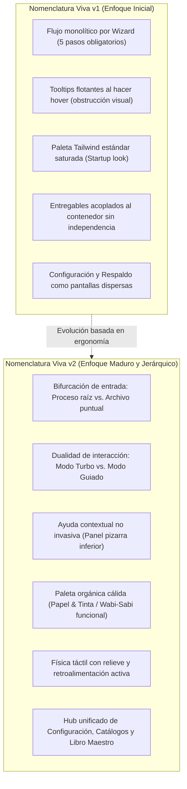
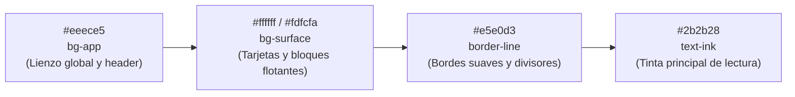
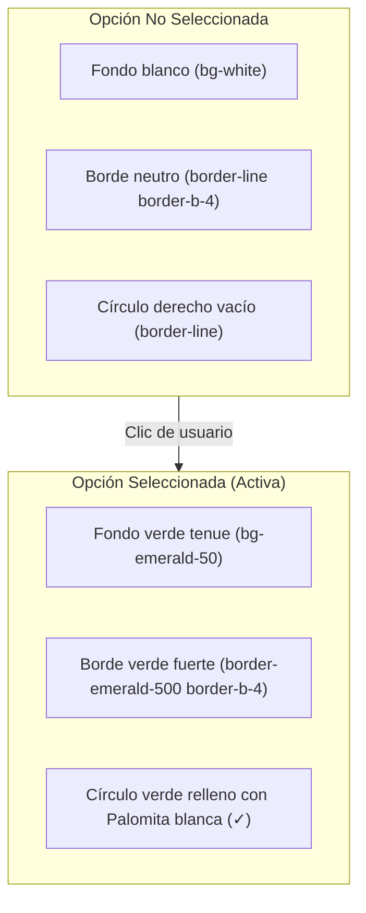
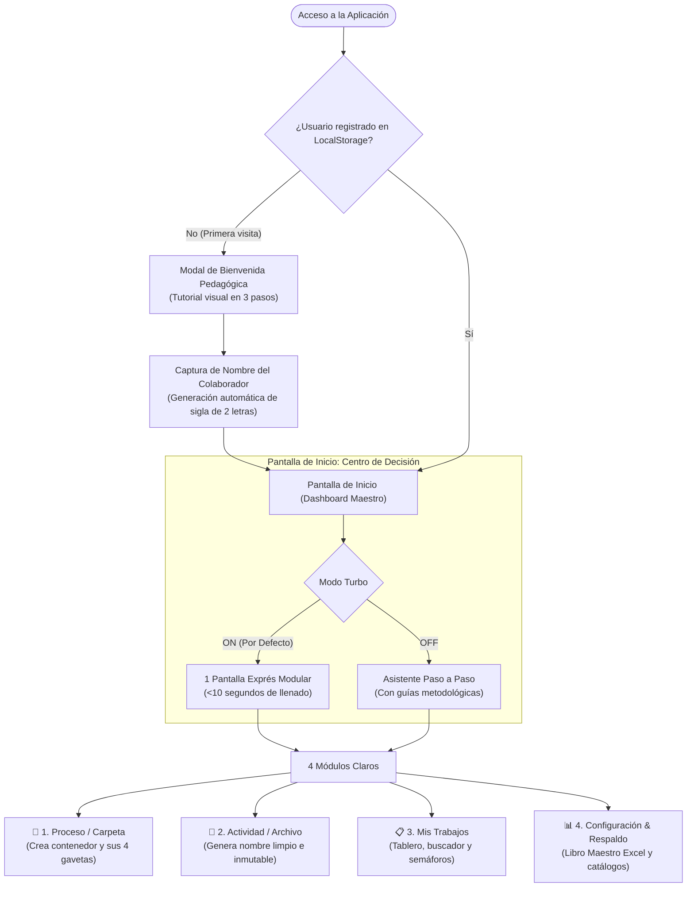
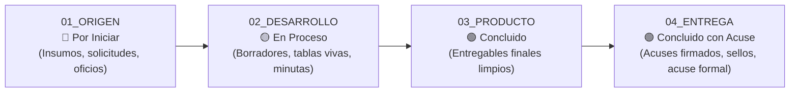
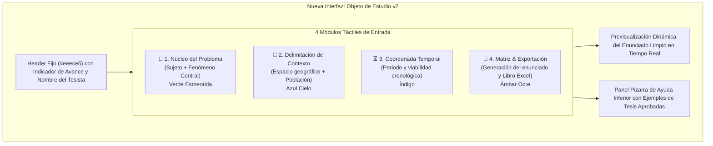
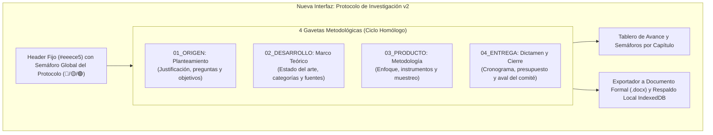

# Sistema de Diseño y Secuencia Jerárquica: Nomenclatura Viva (v1 y v2)
## Guía de Arquitectura Visual, UI/UX y Manual de Replicación para Aplicaciones Institucionales

> **Ubicación del Documento:** `/root/proyectos/informe-sistema-diseno-nomenclatura-v1-v2.md`  
> **Ecosistema de Referencia:** Aplicaciones Web de la Universidad Marista de Querétaro (CIITE & Dirección de Investigación)  
> **Aplicaciones de Referencia Analizadas:** Nomenclatura Viva v1 (`/app`) y Nomenclatura Viva v2 (`/app_v2`)  
> **Aplicaciones Objetivo de Replicación:** *Delimitación del Objeto de Estudio* (`App_Objeto_Estudio_Marista`) y *Protocolo de Investigación* (`protocolodi.aplicacion`)

---

## 1. Resumen Ejecutivo y Propósito de este Informe

El presente informe desglosa de manera exhaustiva el **Sistema de Diseño (Design System)**, la **física de componentes de interfaz (UI)** y la **secuencia jerárquica de experiencia de usuario (UX)** desarrollados y consolidados en la transición de **Nomenclatura Viva v1 a Nomenclatura Viva v2**.

El objetivo central de este documento es servir como **plano maestro y manual de construcción visual** para trasladar este estándar ergonómico, pedagógico y funcional a **otras dos aplicaciones clave del ecosistema institucional**:
1. **Delimitación del Objeto de Estudio** (`/root/proyectos/App_Objeto_Estudio_Marista/delimitacion_objeto_estudio.html`)
2. **Protocolo de Investigación** (`/root/proyectos/protocolodi.aplicacion/index.html`)

Ambas herramientas comparten con Nomenclatura Viva el público objetivo (investigadores, coordinadores, docentes y alumnos de posgrado) y la necesidad crítica de **reducir la fricción cognitiva, eliminar la sobrecarga visual de formularios extensos y estructurar secuencias operativas intuitivas**.

---

## 2. Radiografía Comparativa: Evolución de Diseño v1 vs. v2

Comprender la evolución entre ambas versiones permite identificar las decisiones que transformaron una herramienta técnica en un producto fluido y adoptado masivamente:



### Tabla Comparativa de Atributos UI/UX

| Dimensión | Versión 1 (`app`) | Versión 2 (`app_v2`) | Impacto en el Usuario |
| :--- | :--- | :--- | :--- |
| **Arquitectura de Información** | 4 acciones básicas: *Nuevo Trabajo, Mis Trabajos, Respaldo, Configuración*. | 4 módulos jerárquicos: *📁 Proceso/Carpeta, 📄 Actividad/Archivo, 📋 Mis Trabajos, 📊 Configuración & Respaldo*. | Separa el contenedor general del archivo diario sin forzar wizards largos. |
| **Curva de Aprendizaje** | Asistente de 5 pasos rígido. Lento para usuarios diarios. | **Doble modalidad:** `Modo Turbo` (captura en 1 sola pantalla en <10s) vs `Modo Guiado` (asistente pedagógico). | Elimina la frustración del usuario experto y no abandona al novato. |
| **Sistema de Ayuda** | Tooltips flotantes al pasar el mouse. En móviles se bloqueaban o tapaban los inputs. | Componente `<BotonAyuda />` con pastilla dedicada que abre un panel inferior en fondo pizarra contrastado. | **Cero obstrucción visual**. El usuario lee la ayuda mientras sigue viendo sus campos. |
| **Paleta Cromática** | Colores Tailwind puros saturados (`emerald-500`, `blue-500`). | Paleta cálida y apagada: `paper`, `app`, `surface`, `ink`, acentos `moss`, `ai`, `kaki`, `budou`. | Ambiente sereno que reduce la fatiga visual en jornadas de oficina prolongadas. |
| **Física de Botones** | Botones planos con sombras estándar (`shadow-sm`). | Relieve táctil tipo bloque físico (`border-b-4`, elevación en `hover` y compresión en `active`). | Claridad absoluta entre lo que se toca y lo que es meramente informativo. |
| **Niveles de Trazabilidad** | Estado mezclado en el formulario. | Separación tajante: nombre inmutable + semáforo visual de 3 estados (🔴, 🟡, 🟢). | Erradica nombres viciados como *"archivo_revisado_final2.docx"*. |

---

## 3. Paleta Cromática y Tokens de Diseño

La estética de Nomenclatura Viva combina dos capas visuales complementarias:
1. **Un lienzo de fondo y texto neutro, cálido y mate** (inspirado en la textura del papel y tinta tradicional).
2. **Botones de acción táctiles con gradientes vibrantes y borde inferior reforzado** que guían la mirada a las decisiones principales.

### 3.1 Lienzo de Fondo y Tipografía (Paper & Ink)

El fondo general de la ventana y el header comparten la misma tonalidad cálida (`#eeece5`), logrando que las tarjetas blancas (`#ffffff` / `#fdfcfa`) actúen como "hojas de papel" sobre un escritorio:



| Token / Variable | Hexadecimal | Clases Tailwind | Uso y Rol en la Interfaz |
| :--- | :--- | :--- | :--- |
| **`app`** | `#eeece5` | `bg-app` | Fondo estructural global de toda la pantalla y barra superior fija. |
| **`surface`** | `#fdfcfa` | `bg-surface` o `bg-white` | Superficie de tarjetas de captura, formularios, listas y modales. |
| **`paper`** | `#f7f5f0` | `bg-paper` | Fondos de contraste suave para agrupaciones secundarias. |
| **`line`** | `#e5e0d3` | `border-line` | Líneas de división, bordes de inputs inactivos y separadores limpios. |
| **`ink` (Predeterminado)** | `#2b2b28` | `text-ink` | Títulos principales, encabezados y etiquetas de formularios. |
| **`ink-soft`** | `#6b6660` | `text-ink-soft` | Subtítulos, textos explicativos, descripciones de ayuda. |
| **`ink-faint`** | `#a39d92` | `text-ink-faint` | Placeholders, metadatos secundarios y marcas de fecha. |

### 3.2 Acentos Cromáticos Funcionales (Código de Color de Secciones)

Cada módulo o concepto clave tiene asignada una identidad cromática estricta que se mantiene invariable en botones, encabezados, pestañas e insignias:

| Módulo / Rol | Nombre Clave | Gradiente del Botón | Borde Inferior / Sombra | Identificador Visual |
| :--- | :--- | :--- | :--- | :--- |
| **Procesos / Creación** | Verde Esmeralda (`moss`) | `from-emerald-400 to-emerald-600` | `border-emerald-800/50` / `shadow-emerald-700/30` | 📁 Proceso raíz, 4 gavetas, confirmaciones, botón primario. |
| **Archivos / Trazabilidad** | Azul Cielo / Índigo (`ai`) | `from-sky-400 to-blue-600` | `border-blue-800/50` / `shadow-blue-700/30` | 📄 Entregables, documentos individuales, enlaces externos. |
| **Consultas / Tablero** | Índigo Púrpura | `from-indigo-400 to-indigo-600` | `border-indigo-800/50` / `shadow-indigo-700/30` | 📋 Monitoreo, árbol de carpetas, semáforos, estadísticas. |
| **Configuración / Respaldo** | Ámbar Ocre (`kaki`) | `from-amber-400 to-orange-500` | `border-orange-700/50` / `shadow-orange-600/30` | 📊 Descarga Excel (.xlsx), catálogos de área, sincronización. |
| **Peligro / Eliminación** | Terracota (`terracotta`) | `from-red-400 to-red-600` | `border-red-800/50` / `shadow-red-700/30` | 🗑️ Eliminar registros, resetear datos, advertencias críticas. |
| **Paneles de Ayuda (Contraste)** | Pizarra Oscura | `bg-slate-900 border-slate-700` | `shadow-xl text-white` | 💡 Panel inferior desplegable con texto blanco y acentos ámbar. |

---

## 4. Física del Componente: Principios UI y Comportamiento Táctil

Una de las firmas más notorias de Nomenclatura Viva es su **física de interacción tangible**.

> [!IMPORTANT]
> **La Regla de Oro UI de Nomenclatura Viva:**  
> *"Todo lo que se puede tocar tiene volumen, relieve tridimensional y respuesta física al clic; todo lo que es puramente informativo se mantiene plano."*

### 4.1 Anatomía del Botón Presionable (`PRESIONABLE`)

Los botones no dependen de un simple cambio de opacidad en hover; se comportan como teclas de teclado físico con las siguientes etapas:

1. **Estado Reposo:** Posee una base sólida con borde inferior de 4 píxeles (`border-b-4`) y sombra pronunciada (`shadow-md`).
2. **Estado Hover (Pasar el mouse):** El botón "se levanta" 1 píxel hacia arriba (`-translate-y-0.5` o `-translate-y-1`) y la sombra se proyecta con mayor profundidad (`shadow-lg` o `shadow-xl`).
3. **Estado Active (Presionar/Clic):** El botón "se hunde" físicamente (`translate-y-0.5`), el borde inferior se comprime (`border-b-2`) y la sombra se reduce drásticamente (`shadow-sm`).
4. **Estado Focus:** Un aro de enfoque accesible de 4 píxeles (`focus-visible:ring-4`) asegura navegación perfecta con teclado.

```css
/* Token de comportamiento táctil para cualquier botón */
.presionable {
  transition: all 150ms ease-in-out;
}
.presionable:hover {
  transform: translateY(-2px);
  box-shadow: 0 10px 15px -3px rgba(0, 0, 0, 0.1);
}
.presionable:active {
  transform: translateY(2px);
  border-bottom-width: 2px;
  box-shadow: 0 1px 2px 0 rgba(0, 0, 0, 0.05);
}
```

### 4.2 Tarjetas de Selección Múltiple / Unitaria (`<Opcion />`)

Para formularios de toma de decisiones (seleccionar un área, un tipo de documento o una etapa metodológica), no se utilizan selects desplegables escondidos, sino **tarjetas táctiles con confirmación de estado visual**:



### 4.3 Pestañas tipo Control Segmentado (`<Pestanas />`)

En lugar de pestañas web tradicionales con líneas inferiores planas, Nomenclatura Viva utiliza un **contenedor en pastilla con botones flotantes**:
- Contenedor con borde redondeado profundo (`rounded-2xl bg-ink/5 p-1`).
- La pestaña activa adopta el gradiente tridimensional de su sección (`shadow-md border-b-[3px] text-white`).
- Las pestañas inactivas presentan texto neutro y se elevan ligeramente al pasar el mouse.

### 4.4 Pastillas de Selección Rápida (`<Pastilla />`)

Para listas extensas de sugerencias (ej. áreas frecuentes, ejemplos de claves o autores):
- Forma de pastilla redondeada completa (`rounded-full px-3 py-1.5 text-xs`).
- Estado activo: fondo del color de la sección con texto blanco y borde inferior de 3 píxeles.
- Permite seleccionar con un solo toque sin abrir menús desplegables.

---

## 5. Secuencia Jerárquica de Usuario (Flujo UX y Navegación)

La secuencia jerárquica de usuario en Nomenclatura Viva v2 resolvió el mayor problema de las herramientas de software complejas: **la fatiga del usuario frente a formularios interminables**.



### 5.1 Onboarding Sin Fricción y Soberanía Local

1. **Modal de Bienvenida Educativo:** Al entrar por primera vez, un modal animado ilustra en tres tarjetas con diagramas cómo funciona la metodología (Contenedor ➔ 4 Gavetas ➔ Archivo ➔ Semáforo).
2. **Identificación Inmediata:** Solicita el nombre del usuario y calcula de inmediato su sigla de autor (ej. *Martín Aguilar ➔ MA*), almacenándola en `localStorage`. Nunca pide contraseñas complejas ni correos institucionales.
3. **Persistencia Local Automática:** La aplicación opera en el navegador con IndexedDB (`Dexie.js`). Si se corta internet, la app sigue funcionando al 100%.

### 5.2 La Dualidad de Flujo: Modo Turbo vs. Modo Guiado

El switch ubicado en la parte superior derecha de la pantalla de inicio permite alternar el comportamiento de la aplicación:

| Característica | Modo Turbo (Activado) | Modo Guiado (Desactivado) |
| :--- | :--- | :--- |
| **Público Objetivo** | Personal experimentado, uso diario. | Nuevos ingresos, capacitación, auditorías. |
| **Disposición de Pantalla** | **Todo en una sola vista** dividida en tarjetas claras. | Secuencia de pantallas sucesivas (Paso 1, 2, 3...). |
| **Tiempo de Completitud** | Menos de 10 segundos por proceso. | 1 a 2 minutos con lecturas explicativas. |
| **Previsualización** | Actualización instantánea en vivo con botón para copiar. | Explicación de cada fragmento antes de avanzar. |

### 5.3 Sistema de Ayuda Contextual No Invasiva

Los sistemas de ayuda tradicionales fallan porque los *tooltips* o ventanas modales tapan los campos que el usuario está intentando llenar. En Nomenclatura Viva v2 se implementó una **regla de diseño estricta**:

1. Debajo de cada tarjeta de acción o sección de formulario se coloca un botón pastilla: `<BotonAyuda />`.
2. Al presionarlo, **no emerge una ventana flotante**, sino que se desliza un panel inferior fijo en **fondo pizarra oscuro (`bg-slate-900 text-white`)**.
3. El panel presenta una plantilla invariable:
   - **¿Qué es?** (Definición conceptual sintética).
   - **¿Cuándo usarlo?** (Criterio operativo concreto).
   - **Ejemplo práctico:** (Código o caso institucional real resaltado en ámbar monoespaciado).
4. El usuario puede leer la explicación y **al mismo tiempo hacer clic o escribir en los campos de arriba** sin que la ayuda se cierre ni le estorbe.

### 5.4 La Metodología de las 4 Gavetas Operativas

Todo proceso o contenedor institucional generado se divide obligatoriamente en 4 subcarpetas fijas que ordenan la vida del proyecto:



### 5.5 Regla de Oro en el Bautizo de Archivos y Semáforo Dinámico

- **Nombre Limpio e Inmutable:**  
  `[TIPO]-[CONSECUTIVO]_[CLAVE-CORTA]_[FECHA].ext`  
  *Ejemplo:* `INFORME-001_AULA26_2026-11-17.pdf`  
  *(Nunca se altera para poner palabras como "v2", "borrador", "final_final")*.
- **Semáforo Dinámico:**  
  El estado del archivo se gestiona en la base de datos local y en el Libro Maestro de Excel mediante un semáforo interactivo:
  - 🔴 **Rojo (Por Iniciar):** Documento solicitado o plantilla vacía.
  - 🟡 **Amarillo (En Proceso):** Archivo en redacción o revisión de pares.
  - 🟢 **Verde (Concluido):** Archivo validado, firmado o entregado.

---

## 6. Blueprint y Guía de Replicación para las Otras 2 Aplicaciones

La Universidad Marista de Querétaro cuenta en `/root/proyectos` con dos aplicaciones web clave de apoyo a la investigación:
1. **Delimitación del Objeto de Estudio** (`/root/proyectos/App_Objeto_Estudio_Marista/delimitacion_objeto_estudio.html`)
2. **Protocolo de Investigación** (`/root/proyectos/protocolodi.aplicacion/index.html`)

Actualmente, ambas herramientas funcionan en archivos monolíticos HTML con hojas de estilo CSS tradicionales (`--bg: #eef2f7`, tablas rígidas, botones planos, formularios largos que abruman al investigador y falta de ayudas contextuales integradas).

A continuación se detalla el esquema exacto de transformación visual y jerárquica para cada una:

---

### 6.1 Aplicación 1: Delimitación del Objeto de Estudio (Modelo MITI)

#### Diagnóstico Actual
La herramienta actual guía al alumno o investigador a formular su objeto de estudio a través de variables complejas (Sujeto, Contexto, Fenómeno, Delimitación Temporal y Espacial). En su estado actual, se presenta como un documento largo y vertical tipo formulario gubernamental.

#### Transformación con el Sistema de Diseño Nomenclatura Viva



#### Blueprint de Componentes Específicos:
1. **Encabezado y Lienzo:** Fondo cálido `#eeece5`, tipografía carbón `#2b2b28`.
2. **Modo Turbo vs. Modo Asesorado:**
   - *Modo Turbo:* Para investigadores experimentados que solo desean vaciar los campos sintéticos en una matriz de 1 sola pantalla.
   - *Modo Asesorado:* Para tesistas de licenciatura/maestría, con preguntas detonadoras paso a paso.
3. **Caja de Previsualización en Vivo (Live Preview):** Un bloque visual superior que va ensamblando el enunciado de investigación en tiempo real conforme el usuario escribe:
   $$\text{"El fenómeno } \mathbf{[X]} \text{ en la población de } \mathbf{[Y]} \text{ dentro del contexto } \mathbf{[Z]} \text{ durante } \mathbf{[T]}"$$
4. **Botón de Ayuda Contextual en Pizarra (`bg-slate-900`):** En cada campo (ej. *Sujeto de estudio*), un botón `💡 Ayuda` despliega la tarjeta oscura explicando qué es, cuándo considerarlo delimitado y un ejemplo real de tesis aprobada por la Universidad.

---

### 6.2 Aplicación 2: Protocolo de Investigación Institucional

#### Diagnóstico Actual
El Protocolo de Investigación abarca el ciclo completo de una investigación académica (Planteamiento del problema, Justificación, Marco Teórico, Metodología, Cronograma y Presupuesto). Su tamaño actual intimida al usuario novel y carece de un sistema visual de semaforización de avance.

#### Transformación con el Sistema de Diseño Nomenclatura Viva



#### Blueprint de Componentes Específicos:
1. **Estructura en 4 Gavetas Metodológicas:** Mapeo 1 a 1 con el concepto de Nomenclatura Viva:
   - `01_ORIGEN` ➔ Planteamiento del Problema, Justificación y Preguntas de Investigación.
   - `02_DESARROLLO` ➔ Marco Teórico, Antecedentes y Categorías Analíticas.
   - `03_PRODUCTO` ➔ Metodología de Investigación, Tipo de Estudio, Muestra e Instrumentos.
   - `04_ENTREGA` ➔ Cronograma, Recursos, Presupuesto y Acuse de Aprobación por Comité de Bioética/Investigación.
2. **Semáforo de Dictaminación:** Cada capítulo del protocolo tiene su semáforo tricolor (🔴 Sin rediseñar / 🟡 En borrador / 🟢 Validado por el Asesor).
3. **Botones Presionables con Relieve Táctil:**
   - Botón verde esmeralda para guardar avance y registrar avances capitulares.
   - Botón azul para adjuntar o enlazar instrumentos de recolección (encuestas, entrevistas).
   - Botón ámbar para generar el Respaldo Maestro en Excel o descargar el archivo consolidado.
4. **Protección Local de Datos:** Si el tesista cierra accidentalmente la ventana, la aplicación escucha el evento `beforeunload` y guarda cada párrafo en IndexedDB local de inmediato.

---

## 7. Biblioteca de Componentes Reutilizables (Código Listo para Replicar)

A continuación se entregan las piezas de código canónicas en **HTML / Tailwind CSS / React** para ser implementadas de inmediato en las otras aplicaciones:

### 7.1 Botón Táctil Tridimensional (`BotonTáctil`)

```tsx
import type { ButtonHTMLAttributes, ReactNode } from "react";

type ColorBoton = "verde" | "azul" | "ambar" | "morado" | "rojo" | "blanco";

const COLORES = {
  verde: "text-white bg-gradient-to-br from-emerald-400 to-emerald-600 border-emerald-800/50 shadow-emerald-700/30 hover:from-emerald-300 hover:to-emerald-500 focus-visible:ring-emerald-300",
  azul: "text-white bg-gradient-to-br from-sky-400 to-blue-600 border-blue-800/50 shadow-blue-700/30 hover:from-sky-300 hover:to-blue-500 focus-visible:ring-sky-300",
  ambar: "text-white bg-gradient-to-br from-amber-400 to-orange-500 border-orange-700/50 shadow-orange-600/30 hover:from-amber-300 hover:to-orange-400 focus-visible:ring-amber-300",
  morado: "text-white bg-gradient-to-br from-indigo-400 to-indigo-600 border-indigo-800/50 shadow-indigo-700/30 hover:from-indigo-300 hover:to-indigo-500 focus-visible:ring-indigo-300",
  rojo: "text-white bg-gradient-to-br from-red-400 to-red-600 border-red-800/50 shadow-red-700/30 hover:from-red-300 hover:to-red-500 focus-visible:ring-red-300",
  blanco: "text-[#2b2b28] bg-white border-[#e5e0d3] shadow-black/5 hover:border-emerald-300 focus-visible:ring-emerald-300",
};

export function BotonTactil({
  color = "verde",
  children,
  className = "",
  ...props
}: ButtonHTMLAttributes<HTMLButtonElement> & { color?: ColorBoton }) {
  return (
    <button
      type="button"
      className={`inline-flex items-center justify-center gap-2 px-4 py-2.5 rounded-xl font-bold text-sm border-b-4 shadow-md transition-all duration-150 hover:-translate-y-0.5 hover:shadow-lg active:translate-y-0.5 active:border-b-2 active:shadow-sm focus:outline-none focus-visible:ring-4 disabled:opacity-50 disabled:cursor-not-allowed disabled:hover:translate-y-0 ${COLORES[color]} ${className}`}
      {...props}
    >
      {children}
    </button>
  );
}
```

### 7.2 Tarjeta de Opción Seleccionable (`TarjetaOpcion`)

```tsx
import type { ReactNode } from "react";

export function TarjetaOpcion({
  seleccionada = false,
  icono,
  titulo,
  subtitulo,
  onClick,
}: {
  seleccionada: boolean;
  icono?: ReactNode;
  titulo: string;
  subtitulo?: string;
  onClick: () => void;
}) {
  return (
    <button
      type="button"
      onClick={onClick}
      aria-pressed={seleccionada}
      className={`w-full text-left flex items-center gap-3.5 rounded-2xl p-4 border-2 border-b-4 shadow-sm transition-all duration-150 hover:-translate-y-0.5 hover:shadow-md active:translate-y-0.5 active:border-b-2 focus:outline-none focus-visible:ring-4 focus-visible:ring-emerald-300 ${
        seleccionada
          ? "bg-emerald-50 border-emerald-500"
          : "bg-white border-[#e5e0d3] hover:border-emerald-300"
      }`}
    >
      {icono && (
        <span className="shrink-0 w-12 h-12 rounded-xl bg-[#eeece5] flex items-center justify-center text-2xl">
          {icono}
        </span>
      )}
      <div className="flex-1 min-w-0">
        <span className="block font-bold text-[#2b2b28] text-sm sm:text-base leading-snug">
          {titulo}
        </span>
        {subtitulo && (
          <span className="block text-xs text-[#6b6660] mt-1 leading-snug">
            {subtitulo}
          </span>
        )}
      </div>
      <span
        className={`shrink-0 w-6 h-6 rounded-full border-2 flex items-center justify-center transition-colors ${
          seleccionada
            ? "bg-emerald-500 border-emerald-500 text-white"
            : "border-[#e5e0d3] bg-white"
        }`}
      >
        {seleccionada && (
          <svg viewBox="0 0 24 24" fill="none" stroke="currentColor" strokeWidth={3} strokeLinecap="round" strokeLinejoin="round" className="w-3.5 h-3.5">
            <path d="m5 12.5 4.5 4.5L19 7.5" />
          </svg>
        )}
      </span>
    </button>
  );
}
```

### 7.3 Panel de Ayuda Contextual en Pizarra (`PanelAyudaPizarra`)

```tsx
import { useState } from "react";

export function ModuloConAyuda({
  titulo,
  queEs,
  cuandoUsar,
  ejemplo,
  children,
}: {
  titulo: string;
  queEs: string;
  cuandoUsar: string;
  ejemplo: string;
  children: React.ReactNode;
}) {
  const [abierta, setAbierta] = useState(false);

  return (
    <div className="w-full flex flex-col gap-3">
      {/* Contenido interactivo principal */}
      <div className="w-full">{children}</div>

      {/* Botón inferior tipo pastilla no invasivo */}
      <div className="self-start">
        <button
          type="button"
          onClick={() => setAbierta(!abierta)}
          className={`inline-flex items-center gap-1.5 px-3 py-1.5 rounded-full text-xs font-semibold border transition-all cursor-pointer ${
            abierta
              ? "bg-amber-100 border-amber-300 text-amber-900 font-bold ring-2 ring-amber-200"
              : "bg-white border-slate-200 text-slate-600 hover:text-slate-900 hover:bg-slate-50"
          }`}
        >
          <span>💡</span>
          <span>{abierta ? "Ocultar ayuda" : `¿Para qué sirve ${titulo}?`}</span>
        </button>
      </div>

      {/* Panel Pizarra Desplegable: Nunca cubre los campos de arriba */}
      {abierta && (
        <div className="w-full bg-slate-900 text-white rounded-2xl p-4 sm:p-5 shadow-xl border border-slate-700 animate-in fade-in space-y-3">
          <div className="flex items-center justify-between border-b border-slate-800 pb-2">
            <div className="flex items-center gap-2">
              <span className="text-xl">💡</span>
              <h3 className="font-bold text-amber-300 text-sm sm:text-base">Guía: {titulo}</h3>
            </div>
            <button
              type="button"
              onClick={() => setAbierta(false)}
              className="px-2 py-0.5 rounded-lg bg-slate-800 hover:bg-slate-700 text-slate-300 text-xs font-semibold"
            >
              ✕ Cerrar
            </button>
          </div>

          <div className="grid grid-cols-1 sm:grid-cols-2 gap-4 text-xs sm:text-sm">
            <div className="space-y-1">
              <strong className="text-emerald-400 block text-xs uppercase tracking-wider">¿Qué es?</strong>
              <p className="text-slate-200 leading-relaxed">{queEs}</p>
            </div>
            <div className="space-y-1">
              <strong className="text-sky-400 block text-xs uppercase tracking-wider">¿Cuándo usarlo?</strong>
              <p className="text-slate-200 leading-relaxed">{cuandoUsar}</p>
            </div>
          </div>

          <div className="p-2.5 rounded-xl bg-slate-800/90 border border-slate-700 font-mono text-xs text-amber-200 flex items-center gap-2">
            <span className="text-[11px] text-slate-400 font-sans uppercase font-bold shrink-0">Ejemplo práctico:</span>
            <span className="break-all">{ejemplo}</span>
          </div>
        </div>
      )}
    </div>
  );
}
```

---

## 8. Checklist de Implementación y Control de Calidad Visual

Al desplegar este diseño en las dos nuevas aplicaciones, verificar el cumplimiento de los siguientes puntos:

- [ ] **Fondo Homogéneo:** Tanto la etiqueta `<body>` como la barra superior del `<header>` comparten exactamente el fondo cálido `#eeece5`.
- [ ] **Superficie de Tarjetas:** Todo contenedor interactivo es blanco (`#ffffff`) con bordes suaves `#e5e0d3` y radio pronunciado (`rounded-2xl`).
- [ ] **Profundidad Física en Botones:** Ningún botón de decisión principal es plano; todos poseen `border-b-4`, elevación en `hover` y compresión en `active`.
- [ ] **Modo Turbo / Guiado:** Los formularios de más de 3 preguntas ofrecen un control switch superior para alternar entre "Captura Rápida en 1 Pantalla" y "Asistente Guiado Paso a Paso".
- [ ] **Cero Tooltips Flotantes Invasivos:** Las explicaciones se delegan en el `<BotonAyuda />` con panel inferior en fondo pizarra `bg-slate-900`.
- [ ] **Semáforos de Trazabilidad:** Todo entregable o capítulo cuenta con su indicador semafórico de tres estados (🔴 Por Iniciar / 🟡 En Proceso / 🟢 Concluido).
- [ ] **Almacenamiento Soberano (Zero-Knowledge):** No enviar datos de la investigación a APIs externas; guardar en IndexedDB local con exportación a hoja de cálculo Excel (`.xlsx`) y JSON respaldable.
- [ ] **Prevención de Pérdida de Datos:** Suscribir el listener `beforeunload` para impedir que el usuario cierre la ventana si tiene avances sin descargar o respaldar.

---

## 9. Conclusión y Próximos Pasos

El estándar visual y metodológico de **Nomenclatura Viva v2** demuestra que el software académico e institucional puede ser altamente riguroso sin ser aburrido ni intimidante. Al adoptar la paleta orgánica de papel y tinta, la física táctil con relieve y la separación funcional entre modo turbo y asistido, las aplicaciones de **Delimitación del Objeto de Estudio** y **Protocolo de Investigación** elevarán sustancialmente la satisfacción, retención y velocidad de trabajo de la comunidad académica y de investigación.
