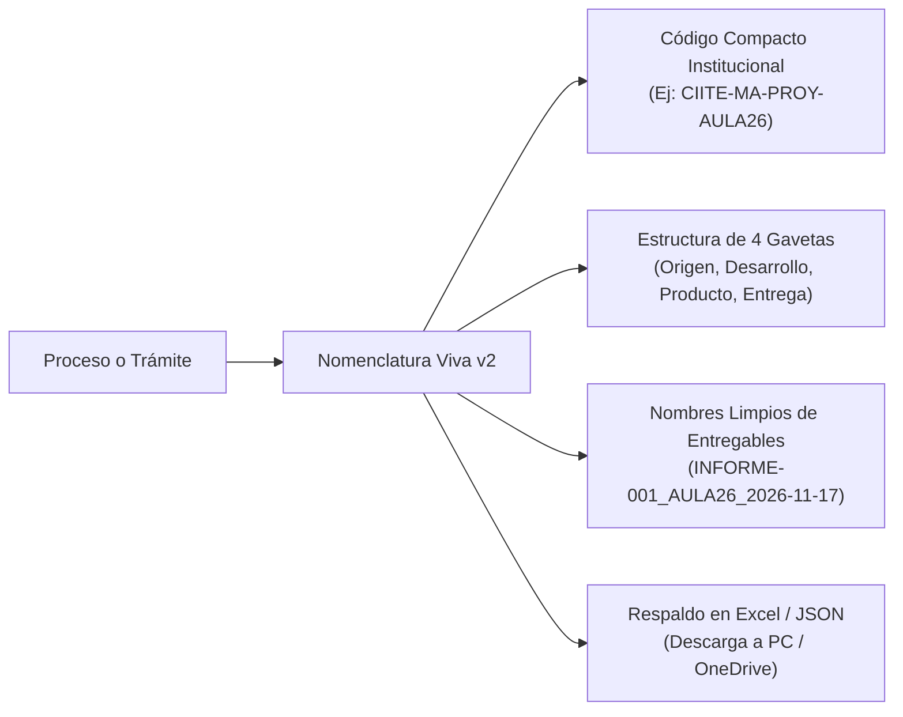
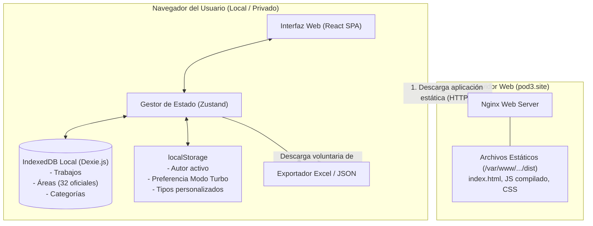

**Estado de Publicación:** Activa en producción  
**URL Pública:** `https://nomenclaturavivaappv2.pod3.site`  
**Ubicación en Servidor:** `/var/www/nomenclaturavivaappv2` (Código fuente en `/root/proyectos/Nomenclatura_Viva_APP/app_v2`)  
**Desarrollado para:** Universidad Marista de Querétaro (CIITE & Área de Investigación)  

---

## 1. Resumen Ejecutivo y Propósito del Sistema

La aplicación **Nomenclatura Viva v2** es una solución web de ordenamiento documental y trazabilidad de procesos institucionales. Nació para erradicar el caos de nomenclatura en carpetas y archivos compartidos (evitando nombres informales como *"copia_final_v2_revisado_ok.docx"*), permitiendo a cualquier dependencia académica o administrativa:

1. **Generar códigos compactos, estandarizados y trazables** (`[ÁREA]-[AUTOR]-[CATEGORÍA]-[CLAVE]`).
2. **Estructurar automáticamente carpetas en 4 gavetas operativas** (`01_ORIGEN`, `02_DESARROLLO`, 03_PRODUCTO`, `04_ENTREGA`).
3. **Bautizar entregables y documentos de forma limpia**, separando el nombre permanente del archivo de su estado dinámico (resuelto mediante un semáforo de seguimiento).
4. **Garantizar privacidad absoluta y soberanía de datos**: la aplicación opera en modalidad *Zero-Knowledge* / *Client-Side Only*, sin almacenar información institucional en bases de datos externas.

---

## 2. Arquitectura de Software e Infraestructura

### 2.1 Pila Tecnológica (Tech Stack)

| Capa | Tecnologías | Rol en el Sistema |
| :--- | :--- | :--- |
| **Frontend Framework** | React 18 + TypeScript | Construcción de interfaces reactivas, tipado estricto de reglas de negocio y validación de esquemas. |
| **Bundler & Build Tool** | Vite 5 | Compilación ultrarrápida a un paquete estático optimizado (Single Page Application - SPA). |
| **Estilos y UI** | Tailwind CSS + PostCSS | Diseño responsivo accesible, paleta institucional con gradientes ergonómicos y jerarquía visual. |
| **Gestión de Estado** | Zustand (`useAppStore.ts`) | Estado reactivo global en memoria para navegación instantánea entre pantallas y filtrado en tiempo real. |
| **Persistencia Local** | Dexie.js (IndexedDB) | Motor de almacenamiento transaccional local en el navegador del usuario (`nomenclatura-viva-v2-db`). |
| **Intercambio y Reportes** | SheetJS (xlsx) + FileSaver.js | Generación y lectura de Libros Maestros en Excel (`.xlsx`) y archivos de sincronización JSON. |
| **Servidor Web & TLS** | Nginx + Certbot Let's Encrypt | Servidor HTTP inverso en Linux sirviendo estáticos sobre HTTPS/HTTP2 con compresión y caching. |

### 2.2 Diagrama de Flujo de Datos y Privacidad

Uno de los pilares esenciales del diseño de la v2 es el principio de **privacidad por diseño**:

> [!NOTE]
> El servidor web **únicamente despacha los archivos estáticos** (HTML, JavaScript, CSS). **Ningún nombre de archivo, documento, área o proceso viaja al servidor.** Todo vive en la máquina del usuario, eliminando riesgos de filtración o custodia indebida de expedientes institucionales.

---

## 3. Modelo Conceptual y Metodología "Nomenclatura Viva"

### 3.1 Anatomía del Código de Proceso / Contenedor

El código institucional sintetiza quién, qué área y qué naturaleza tiene el trabajo sin requerir un sistema informático para interpretarlo a simple vista:

$$\mathbf{[CAMPUS]-[ÁREA]-[AUTOR]-[CATEGORÍA]-[CLAVE]}$$

*Ejemplo:* **`UMQ-CIITE-MA-PROY-AULA26`**

- **Campus / Red (Escalabilidad exterior):** `UMQ` (Universidad Marista de Querétaro), `UMQ-SJR`, o dependencias externas como `UMQ-SEP`.
- **Área:** Sigla oficial del departamento (ej. `CIITE`, `CAJA`, `INVEST`, `ESCOLAR`).
- **Autor:** Sigla generada de 2 a 4 caracteres basada en el colaborador (ej. `MA` para Martín Aguilar).
- **Categoría:** Tipo funcional de actividad institucional (ej. `PROY`, `CONV`, `ADM`, `DIVU`).
- **Clave corta:** Identificador alfanumérico limpio de hasta 20 caracteres (ej. `AULA26`, `PAGOSOCT26`).

### 3.2 El Ciclo de las 4 Gavetas Operativas

Para resolver el problema del desorden en las carpetas de trabajo (sea en Google Drive, OneDrive, Servidor local o archivero físico), la aplicación define un protocolo invariable de 4 subcarpetas por proceso:

| Gaveta | Fase del Trabajo | Semáforo Típico | Contenido y Función |
| :--- | :--- | :---: | :--- |
| **`01_ORIGEN`** | Insumos de Entrada | 🔴 Por Iniciar | Oficios de solicitud, minutas iniciales, lineamientos o convocatorias que disparan la tarea. |
| **`02_DESARROLLO`** | Taller de Trabajo Activo | 🟡 En Proceso | Borradores, hojas de cálculo vivas, versiones de trabajo y material de investigación. |
| **`03_PRODUCTO`** | Entregable Final | 🟢 Concluido | Documentos terminados, validados e impecables listos para su uso o publicación. |
| **`04_ENTREGA`** | Constancia y Cierre | 🟢 Concluido con Acuse | Acuses firmados, sellos de recibido, correos de confirmación o evidencias de entrega formal. |

### 3.3 Regla de Oro en Nomenclatura de Documentos

La versión 2 resuelve uno de los vicios más frecuentes: cambiar el nombre del archivo para indicar su estado (ej. *"Reporte_Corregido_Revisado_Final.pdf"*).

En Nomenclatura v2:
- **El nombre del documento es inmutable y limpio:**  
  `[TIPO]-[CONSECUTIVO]_[CLAVE-CORTA]_[FECHA].ext`  
  *Ejemplo:* `INFORME-001_AULA26_2026-11-17.pdf`
- **El estado evoluciona mediante el Semáforo de Trazabilidad:**  
  🔴 *Por Iniciar* &nbsp; | &nbsp; 🟡 *En Proceso* &nbsp; | &nbsp; 🟢 *Concluido*

---

## 4. Diseño de la Experiencia de Usuario (UI/UX) en v2

### 4.1 Pantalla Principal y Acciones Clave

La pantalla de inicio (`src/components/inicio/Inicio.tsx`) presenta 4 módulos de alta visibilidad diseñados mediante botones con relieve táctil e iconografía descriptiva:

1. **📁 Proceso / Carpeta (Verde Esmeralda):** Crea el expediente raíz y estructura sus 4 gavetas.
2. **📄 Actividad / Archivo (Azul Cielo):** Genera el nombre limpio para un entregable específico dentro de un proceso y actualiza su semáforo.
3. **📋 Mis Trabajos (Índigo):** Tablero central con buscador en tiempo real, filtros combinados (área, categoría, semáforo, fechas) y vista en árbol de carpetas.
4. **📊 Configuración y Respaldo (Ámbar / Naranja):** Panel unificado para descargar el Libro Maestro en Excel (`.xlsx`), sincronizar en JSON y administrar el catálogo institucional de áreas y entregables.

### 4.2 Control de Flujo: Modo Turbo vs. Modo Paso a Paso

Un avance crítico de la versión 2 es la coexistencia fluida de dos modos de interacción:

- **Modo Turbo (Activado por defecto):** Pensado para el personal habitual. Presenta una interfaz unificada en tarjetas modulares donde se selecciona el área favorita, categoría, sigla y clave, generando el código y las rutas en **menos de 10 segundos**.
- **Modo Paso a Paso (Asistente Guiado):** Permite desactivar el modo turbo para colaboradores de nuevo ingreso o capacitación, guiándolos en etapas sucesivas con explicaciones metodológicas en cada paso.

### 4.3 Sistema de Ayuda Contextual No Invasiva

En la versión inicial (v1), las ayudas emergentes flotantes (tooltips en hover) solían tapar los formularios y dificultar la lectura en pantallas táctiles o móviles.  
En la **v2**, se rediseñó bajo el componente homogéneo `<BotonAyuda />`:
- Botón dedicado tipo pastilla debajo de cada tarjeta principal y sección de formulario.
- Al activarse, despliega un panel informativo inferior (fondo pizarra contrastado) que describe:
  - **¿Qué es?**
  - **¿Cuándo usarlo?**
  - **Ejemplo práctico concreto.**
- **Nunca bloquea ni se superpone** a los campos activos.

---

## 5. Catálogo Institucional y Capacidad de Extensión

### 5.1 Las 32 Áreas Oficiales del Organigrama

La aplicación v2 viene precargada con la estructura departamental completa de la Universidad:

| Sector | Áreas Integradas |
| :--- | :--- |
| **Académico y Directivo** | Rectoría (`RECTORIA`), Dirección Académica (`DIRACAD`), Secretaría General (`SECGEN`), Unidad de Publicaciones (`PUBLICAC`), Editorial (`EDITORIAL`), Biblioteca (`BIBLIO`), Coordinación de Inglés (`INGLES`), Educación Continua (`EDCONT`), Acompañamiento Integral (`ACOMP`), Apoyo RVOES (`RVOES`). |
| **Investigación e Innovación** | CIITE (`CIITE`), Área de Investigación (`INVEST`), EVAUM (`EVAUM`). |
| **Operación y Alumnado** | Admisiones (`ADMISION`), Vinculación (`VINC`), Comunicación (`COMUN`), Servicios Escolares (`ESCOLAR`), Pastoral (`PASTORAL`), Servicio Médico (`MEDICO`), Comité de Becas (`BECAS`). |
| **Administración y Finanzas** | Dirección Administrativa (`DIRADM`), RRHH (`RH`), Contabilidad y Finanzas (`FINANZAS`), Caja (`CAJA`), Compras (`COMPRAS`), Control Interno (`CTRLINT`), Compliance (`COMPLIANCE`), Jurídico (`JURIDICO`), Protección Civil (`PROTCIVIL`), Mantenimiento (`MANT`). |
| **Tecnologías y Sistemas** | TICS (`TI`), Desarrollo SIUU (`SIUU`), SIGEM (`SIGEM`). |

> [!TIP]
> Cualquier usuario o departamento puede además **crear y dar de alta nuevas áreas o departamentos personalizados** directamente desde la interfaz, sin requerir reprogramación del software.

### 5.2 Tipos de Entregable Dinámicos

La v2 incorpora un catálogo editable de entregables institucionales (`INFORME`, `OFICIO`, `ACTA`, `POLIZA`, `MINUTA`, `BITACORA`, `FORMATO`, `DICTAMEN`, etc.), asociando a cada uno su gaveta natural de resguardo y numeración secuencial automatizada.

---

## 6. Persistencia, Respaldo y Mecanismo de Intercambio

1. **Almacenamiento Local (IndexedDB):** La información se conserva de forma persistente e inmediata en el navegador local, inmune a cortes de red o pérdidas de sesión.
2. **Respaldo en Hoja de Cálculo (Excel `.xlsx`):** Con un solo clic, la app genera un libro Excel estilizado y formateado que consolida:
   - Resumen y metadatos de autoría y fecha.
   - Lista integral de procesos, rutas, enlaces y semáforos.
   - Detalle de cada documento registrado.
   - Puede ser almacenado por el usuario en su OneDrive institucional, Google Drive o disco local.
3. **Fichero Fuente JSON (.json):** Archivo ligero reimportable con esquema validado mediante *Zod* (`archivoTrabajoSchema`). Permite compartir la base completa entre colaboradores o migrar de equipo sin perder catálogos ni historiales.
4. **Protección contra pérdida de datos:** Escucha el evento `beforeunload` para advertir al colaborador si intenta cerrar el navegador teniendo procesos nuevos sin respaldar.

---

## 7. Infraestructura y Despliegue en Servidor

- **Ruta de Despliegue:** `/var/www/nomenclaturavivaappv2`
- **Configuración de Nginx:** `/etc/nginx/sites-available/nomenclaturavivaappv2`
  - Escucha en el puerto `443` con protocolo HTTPS seguro.
  - Certificado SSL gestionado y renovado automáticamente con Let's Encrypt.
  - Redirección automática de HTTP (puerto 80) a HTTPS.
  - Enrutamiento SPA vía directiva `try_files $uri $uri/ /index.html;`.
